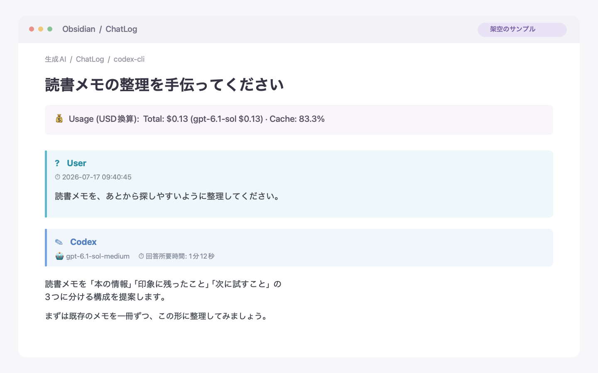
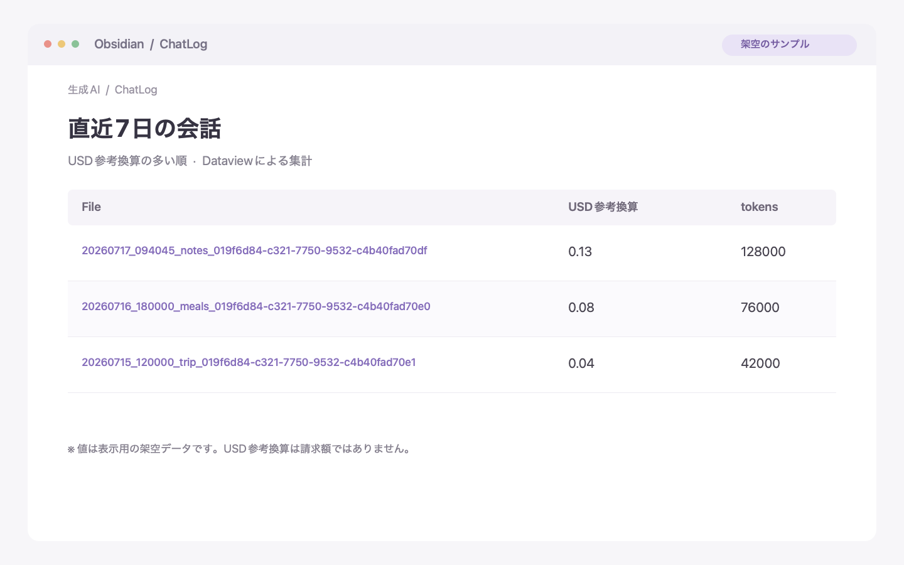

# cli-to-obsidian

**AIと何をして、どれだけ使ったか。会話も使用量も、Obsidianに自動で残す。**

   

Codex・OpenCode・Pi・Claude Code・Antigravityの回答が終わるたびに、会話をObsidianのノートへ自動保存します。使用量を取得できるツールでは、token数・モデル別の内訳・USD参考換算（単価表から計算した比較用の金額で、請求額ではありません）も一緒に記録します。

必要なのは、1〜2ファイルの配置とhookまたはプラグイン／extensionの設定です。**Git・pip・仮想環境は不要です。**

> Automatically save your AI CLI conversations and token usage to Obsidian (macOS).



*架空の会話を使った表示サンプルです。実際の外観はObsidianのテーマや設定により異なります。タイトル・使用量のサマリに続き、ユーザーの発言とAIの回答が並びます。ユーザーの発言とAI名・回答メタデータはCalloutで表示し、AIの回答本文はその下に通常のMarkdownとして表示します。*

## こんなときに

- **「先週のあのバグ、どう直したっけ？」** → Obsidianの検索で、依頼と回答をそのまま読み返せます。ツールの実行結果を除いた会話本文だけが残るので、判断の経緯を追いやすくなります。
- **「今月、どの仕事にAIを多く使った？」** → 会話ごと・モデルごとのtoken数と参考金額を、Dataviewで集計できます。
- **日報や振り返りを書くとき** → 会話ノートへリンクして、成果とその過程を一緒に残せます。

## 対応ツール

**Codex対応を中心に開発しています。** 開発者自身がメインで利用し、日々の開発・動作確認の中心にしています。OpenCodeとPiは今後対応を充実させる予定です。Claude Codeは実利用の経験が少なく、Antigravityは以前メインで使っていましたが現在はほぼ利用していないため、どちらも参考実装として公開しています。

| ツール・導入手順 | 位置づけ | 利用できる環境 | token数・USD参考換算 | quota残量の記録 | 配置するファイル |
| --- | --- | --- | --- | --- | --- |
| [Codex](docs/setup/codex.md) | **主な開発・検証対象** | CLI・ChatGPTデスクトップアプリ内のCodex | 対応 | 対応 | 1個 |
| [OpenCode](docs/setup/opencode.md) | 今後拡充 | CLI・アプリ（v2プラグイン） | 対応 | なし | 2個 |
| [Pi](docs/setup/pi.md) | 今後拡充 | CLI（extension） | 対応 | なし | 2個 |
| [Claude Code](docs/setup/claude-code.md) | 参考実装 | CLI | 対応 | statusLine設定時に対応 | 1個 |
| [Antigravity](docs/setup/antigravity.md) | 参考実装 | CLI・Antigravityアプリ | なし | 対応 | 1個 |

USD参考換算は登録済みモデルが対象です。単価が未登録の場合も、会話と取得できたtoken数は保存します。

ChatGPTの一般的な会話は対象外です。対応するのは、ChatGPTデスクトップアプリ内で実行されるCodexセッションです。

## はじめる

必要なのはmacOS、Python 3.9以上、Obsidian、対応するCLIまたはアプリです。macOS標準の`/usr/bin/python3`で動作確認しています。追加のPythonパッケージは不要です。

1. 上の対応表から使うツールの導入手順を開き、必要な1〜2ファイルをダウンロードします。
2. 保管庫の場所を指定し、hookまたはプラグイン／extensionを設定します。
3. ツールを再起動して1ターン会話し、保管庫にノートが作られることを確認します。

まずCodexで試す場合は、[Codexの導入手順](docs/setup/codex.md)へ進んでください。保存されない場合は[トラブルシューティング](docs/troubleshooting.md)で確認できます。

## 保存した記録を活用する

Dataviewは任意です。会話の保存・閲覧には必要ありません。

開発者が日々使っている[「昨日と今日のAIチャット」ダッシュボード](docs/dataview.md)も公開しています。昨日と今日に更新された会話をざっと見て、元のノートへ戻れる一覧です。ファイルを保管庫へコピーして使えます。集計の意味や設定方法は紹介ページで説明しています。

以下は、別の簡単な集計例です。直近7日の会話を、参考金額の多い順に並べます。

````markdown
```dataview
TABLE usage.total_cost_usd AS "USD参考換算", usage.total_tokens AS "tokens"
FROM "生成AI/ChatLog"
WHERE date(created) >= date(today) - dur(7 days)
SORT usage.total_cost_usd DESC
```
````



*架空のデータを使った集計表示のサンプルです。*

USD参考換算は、実際のサブスクリプション請求額やquota消費量を示すものではありません。また、token数や参考金額の比重は、作業時間の比重とは異なります。

## ドキュメント

| 知りたいこと | 文書 |
| --- | --- |
| ツール別の導入手順 | [Codex](docs/setup/codex.md)・[OpenCode](docs/setup/opencode.md)・[Pi](docs/setup/pi.md)・[Claude Code](docs/setup/claude-code.md)・[Antigravity](docs/setup/antigravity.md) |
| 保管庫・保存先・ファイル名・Templaterテンプレートの設定 | [共通設定](docs/configuration.md) |
| 保存できない・値がない場合の確認、ログ、診断、更新・停止 | [動作確認とトラブルシューティング](docs/troubleshooting.md) |
| token・USD参考換算・quota・所要時間の記録仕様、出力例 | [使用量・金額・quotaの記録仕様](docs/usage-spec.md) |
| 昨日・今日の会話を一覧するDataviewの活用例 | [ダッシュボードの紹介と使い方](docs/dataview.md) |
| 過去の会話の再生成 | [セッション全履歴の再構成](docs/rebuild.md) |
| OTelログとの照合 | [telemetryとの照合](docs/telemetry.md) |
| 開発・テスト、実装上の特徴、単価表の更新 | [開発・テスト](docs/development.md) |

## データの扱いと保存の仕組み

保存スクリプト自身が会話本文や使用量を外部へ送信することはありません。Obsidian保管庫内のMarkdownと、ローカルのstate・診断情報・ログを保存します。AIツール本体やObsidianの同期設定による通信は別です。

Antigravityのquota取得では`agy`の読み取り専用コマンドを呼び出します。任意のtelemetry照合ツール自身は通信しませんが、OTelログの収集を有効にするとCLIから設定した送信先へデータが送られます。詳細は[telemetryとの照合](docs/telemetry.md)を参照してください。

- 同じ内容の再通知ではノートを更新せず、重複保存を避けます。
- 書き込み中断や同時実行に備え、保存済みノートと状態情報から復旧する仕組みを備えています。
- 保存対象はユーザーとAIの会話本文です。ツール呼び出しや実行結果は除外します。

詳しい仕組みは[開発・テスト](docs/development.md)、記録する項目は[記録仕様](docs/usage-spec.md)にあります。

このプロジェクトは各AIサービス・CLI・Obsidianの非公式ツールで、各サービスの開発元とは関係ありません。

## 謝辞

Markdownの出力形式では、[Obsidian AI Exporter](https://github.com/sho7650/obsidian-AI-exporter)のYAML frontmatter、ユーザー発言の見出し、Calloutを使った会話表現を参考にしました。優れたアイデアを公開されている開発者に感謝します。

## バージョン管理

このソースのバージョンは4.3.0です。リリースはリポジトリ全体で共通のバージョン番号を使用し、[Semantic Versioning](https://semver.org/lang/ja/)に従います。各スクリプトの`__version__`と[VERSION](./VERSION)を揃え、公開時に対応するGitタグを付けます。変更履歴は[CHANGELOG](./CHANGELOG.md)に記録しています。

## ライセンス

このプロジェクトは[MIT License](./LICENSE)の下で公開されています。
